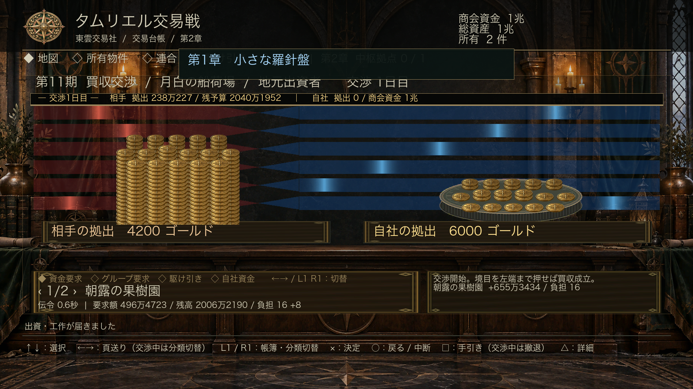

# PB's Tamriel de Trade

ゲーム内名称 **タムリエル交易戦**。ESO内で遊ぶソロ会社経営・買収ミニゲームです。
現在は **本編Phase 5 / v0.25.2：エンバーの結び（真のエンディング）**。5章キャンペーンと最後の大買収まで進められます。

## 今回遊べる範囲

- タムリエル全域と異界の53交易地域・1,303の独自物件、16カテゴリ。羊皮紙色の交易地図・地域索引から選択。
- 地域の開放、地域内訳（自社・敵・中立）、物件一覧・詳細・所有台帳。
- 左に相手、右に自社を置き、青い帯で赤との境目を左端まで押し切れば成功するリアルタイム交渉。境目は中央付近ではゆっくり、端に近づくほど速く動きます。
- 物件への単体資金要求、グループ資金調達、自社資金投入、個性別のCOM。COMも実際の傘下物件を揃えたグループ技を使用します。
- 独立危険度、資金要求時の離反判定、交渉中の暫定的な根回し、交渉後の小回復。
- 地域・業種・特殊系列のグループ閃きと、所有数条件付きの倍率調達。
- 5章のデータ駆動キャンペーンと背景付き章導入。域外地域は第5章で初めて登場。
- ESOクライアントのPOI・住宅・現在地APIから、実在地点をローカライズ済み名称の追加物件として読込。
- 13系統の駆け引き、対象抵抗、時間効果、買収終了時の習得、COMによる個性別の技使用。
- アカウント共通SavedVariables、決算収益、負債返済、調達余力回復、資金枯渇時の再建融資。
- 初回ゲームパッド指南、章開始・閃き・習得・離反・決算・終幕の画面演出とESO内蔵SE。
- 手元資金の減少、連続要求の効率低下、減衰する交渉の勢い。
- 出資に応じた左右の金貨落下・積層、優勢を示す背景帯。
- 買収終了 → NPCからの買収攻撃判定 → 防衛戦 → 資金力ランキングの一連の進行。
- PS5を想定した操作、共通「ゲームセンターPX」メニューとの共存。
- フルスクリーンUI。黒緑・古金・暗い羊皮紙色を基調に、画面比率に合わせて各領域を再配置します。

交渉・防衛・ランキングの後に1期分の決算を行い、所有物件の利益と調達余力を回復します。資金力が規定値を下回ると「経営」タブから再建融資を受けられます。借入は負債となり、以後の利益から返済されます。
進行、所有権、危険度、習得、実機から追加したESO地点をSavedVariablesへ保存します。進行中の交渉そのものは保存せず、閉じている間は停止します。

## 起動

配布ファイル：`dist/PBsTradeGame-0.25.2.zip`

PC/MacではZIP内の `PBsTradeGame` フォルダを、使用中のESOの `live/AddOns/` に配置して有効化します。
親の開発ディレクトリを二重に入れないでください。外部ライブラリは不要です。

- ゲームパッド：メインメニュー → **ゲームセンターPX → タムリエル交易戦**。
- 起動はTetris・WarTableと共通の「ゲームセンターPX」から行います。PC/Macの確認用に `/pbtrade` も利用できます。
- PS5への配布は公式のコンソール向けアップロード・公開手順が別途必要です。このZIPはPS5への公開済みパッケージではありません。

ESO公開ソースのAPI 101050を調査し、近隣PBアドオンに合わせてマニフェストを101050 / 101051に設定しています。
**ESO実機・PS5上でのロードやボタン割当は、この環境ではまだ確認できていません。**

| 操作 | 機能 |
|---|---|
| 十字キー / 左スティック | 前後の項目選択。地図も一定順で全地点を巡回 |
| 左 / 右 | 地域・物件台帳を8項目ずつ移動（交渉中は1コマンドずつ） |
| × / UIの決定キー | 選択、交渉開始、出資 |
| ○ / UIの戻るキー | 戻る。交渉中は閉じて一時停止 |
| L1 / R1 | 地図・所有台帳・グループ・駆け引き・経営の切替（交渉中は無効） |
| □ | 手引き |
| △ | 選択物件の詳細 |

交渉はターン制ではなく、双方の待ち時間とゲージが同時に進むリアルタイム方式です。コマンド選択・手引き・詳細・撤退確認中も進行します。画面非表示と防衛開始前の予告中だけシミュレーションを停止します。戦闘開始・コントローラー切断・ロード画面遷移でも閉じて停止します。
交渉を終わらせるには、コマンドの「交渉から撤退」を選択して確認します。
現金・物件資金の投入は **成功・失敗・撤退のいずれでも消費** します。
すべてミニゲーム内の架空資金であり、キャラクターのESOゴールドや所持品は操作しません。

## 買収後の防衛と順位

買収の成功・失敗・期限切れ・撤退のいずれも、結果画面で決定するとNPCの攻撃判定を一度行います。
攻撃できる資金と物件を持つ敵商会を攻撃性で重み付けして選び、攻撃確率を判定します。
敵は要求負担の高い物件、好む業種、本社を狙いやすくなっています。攻撃元の物件名も通知します。

攻撃があれば、その場でプレイヤーが防衛戦を操作します。
境目を左端まで押し返せば所有権を維持し、右端到達・期限切れ・撤退では相手に所有権が移ります。
防衛戦の後は追加の攻撃判定を連鎖させず、ランキングへ進みます。攻撃がない場合もランキングを表示します。
敵の攻勢は章ごとに強化されます。後半ほど攻撃発生率、初期拠出、追加予算、投入間隔、加速度、駆け引き使用率が上がり、資金力のある敵商会が攻撃役に選ばれやすくなります。敵は自社現金だけでなく傘下物件の調達余力も動員し、高価値・高危険度・本社・得意業種の自社物件を優先して狙います。

ランキングの**資金力＝商会現金＋所有物件の調達用手元資金**。現在順位・前回比・現金・調達余力・総資産・所有数を表示し、自社を最初に選択します。
物件の評価額は総資産に含め、資金力へは二重加算しません。調達余力は複数回の要求で利用する見込み額で、一度に投入できる額ではありません。
NPCの出資は商会現金から実際に減り、防衛結果と合わせて次のランキングへ反映されます。

## 金貨と優勢帯

左の山は相手の累計出資、右は自社の累計出資です。両山は同じ金額スケールです。各山の直下に「相手の拠出」「自社の拠出」と累計ゴールドを大きく表示します。
金貨はリアルな古金の刻印・擦れ・厚みを持つ独自テクスチャで、上から落下して縦に積み上がります。楕円形の台座に奥5本・中央6本・手前5本の柱をずらして配置し、遠近の縮小・陰影・重なりで奥行きを出しています。出資1回ごとの落下時間は金額に応じて約1〜4秒です（v0.5.9）。最初にまとまった金貨が一斉に降り、残りは間隔を広げながらまばらに降って3秒ちょうどで落ち切ります。一斉に降る割合と初速は投入額が大きいほど増します。連続投入は各3秒の演出が重なり、先の演出をリセットしません。着地に合わせESO内蔵の金銭SEを鳴らし、過剰な重なりを抑制します。画面を閉じた中断時間は3秒に含めません。山が高くなると左右それぞれの表示が上層を追い、床が下へ流れて画面外へ退きます。積層数に描画上限は設けず、見えている段と落下中の金貨だけを片側512個の固定プールで描画します。巨額投入時は複数枚を代表する金貨で落下をまとめ、正確な累計額は山の下に表示します。
赤が左の相手、青が右の自社です。相手側の光は左から右、自社側の光は右から左へ流れます。赤と青の境界が買収ゲージそのもので、青が画面全体を押し切ると成立、赤が押し切ると不成立です。重複していた細いゲージは廃止しました。
金貨の山は累計、ゲージの動きは金額差・勢い・減衰を反映するため、両者は同じ意味ではありません。

以下は実際のLua UI定義から作った**開発用レイアウトプレビュー**です。ESO実機のスクリーンショットではありません。
フォント、折り返し、入力、アニメーション速度は実機確認が必要です。



## 開発・検証

```sh
luajit tests/run.lua
lua tests/run.lua
lua tests/hub.lua
luajit tests/ui.lua
python3 scripts/package.py
```

LuaJITではESOに近いLua 5.1構文を検証します。外部サービスやESO接続は不要です。
UIテストはESO APIの契約モックであり、クライアント互換性の保証にはなりません。

任意の開発用アセット再生成（Pillowが必要）：

```sh
python3 scripts/build_assets.py
python3 scripts/build_presentation.py
luajit tests/ui.lua
python3 scripts/render_layout.py
```

描画プレビューにはmacOSの日本語フォントを使用します。DDSは配布物に同梱しているため、利用者にPythonは不要です。

設計・出典：[docs/DESIGN.md](docs/DESIGN.md)  
各Phaseの報告・実機確認：[docs/PHASES.md](docs/PHASES.md)
地域の収録範囲：[docs/WORLD.md](docs/WORLD.md)  
全1,303物件：[docs/PROPERTY_CATALOG.md](docs/PROPERTY_CATALOG.md)

独自原画・組み込み先・制作プロンプト：[ART_BIBLE.md](ART_BIBLE.md)

## v0.1.1 ロードエラー修正

`Bindings.xml` の未定義 `TOGGLE_GAME_MENU` を削除し、Tetris・WarTableと同じUIショートカットだけを許可。一般キー設定への起動登録を外し、「ゲームセンターPX → タムリエル交易戦」を起動導線に統一しました。メニュー生成後の再試行とフックの重複防止を追加しています。

## v0.1.4 画面生成エラー修正

`UI.lua:103` の `SetClipsChildren` はESOのControl APIに存在しないため削除。金貨・台座の表示範囲は、公開API `SetTextureCoords` と表示矩形の切り詰めで処理します。モックから誤ったメソッドを削除し、画面生成・上下端の部分表示・4解像度・実際のMain.lua初期化を回帰検証しました。ゲームセンターPXからの起動方法は同じです。

## v0.1.5 アセットとトレード画面

Tetris・WarTableと同じく `.txt` / `.addon` の両マニフェストへ全DDSを明記し、DDSをDXT5＋完全ミップチェーンへ変更しました。実行時は `PBsTradeGame/` から始まる安定した相対パスを先に使い、検出ルートをフォールバックにします。トレード画面は相手を左、自社を右へ変更し、拠出額を大型プレートに表示。赤は左から右、青は右から左へ光が流れます。

## v0.2.0 Phase 2

資金要求ごとの離反、グループの閃きと倍率調達、暫定根回し、商会性格別AIを追加しました。5章キャンペーンをデータ化し、各章の開始時に独自背景と説明を表示します。コールドハーバー、デッドランドなどタムリエル外の交易地域とモラグ・バル コンツェルンは第5章まで一覧・交渉・ランキングから伏せられます。

## v0.2.1 ESO実在地点カタログ

固定の1,303件はバランス維持用の独自物件です。これに加え、実機起動時にESO APIの `GetPOIInfo` と `GetFastTravelNodeInfo` から標準POI、住宅、宿屋を読み込みます。室内や施設へ移動した際は `GetPlayerLocationName` も記録します。日本語クライアントでは「酔いどれライオン」「マーラの口付け」など、クライアントが返す日本語名をそのまま物件名として使用します。未登録の実在地点にいる状態でゲームを開くと、タイトル画面の先頭に **現在地「物件名」を物件登録** が表示されます。ここで決定すると台帳へ登録され、以後は現在地に関係なく通常の交易地図から買収できます。登録済み地点では登録項目を再表示しません。登録状態と、現地で追加した内部地点はSavedVariablesへ保存されます。

## v0.3.0 Phase 3

商人の微笑み、心づけ、悪評、吟遊詩人、正当性、俊足・偽の伝令、宴席、評議会、市場凍結、席を立つ、離反工作、根回しの13技を実装。技ごとにコスト、効果、時間、習得条件、確率、抵抗キーをデータ化しています。敵商会も性格に応じた技をリアルタイムに使用します。優勢帯の境界は赤・青の三角先端が一点で接する形へ変更しました。

## v0.5.0 Phase 4・5

全キャンペーン状態をアカウント共通SavedVariablesへ保存します。ランキング後の決算で利益、負債返済、物件の調達余力回復を処理し、資金枯渇時は経営タブから再建融資を利用できます。第5章達成時の終幕と自由経営も追加しました。

初回4ページのゲームパッド指南、経営台帳、章開始・閃き・習得・離反・決算・終幕の画面フラッシュとESO内蔵SEを追加しました。既存の独自金庫、羊皮紙地図、章背景、紋章、木枠、リアルな金貨、三角優勢帯、金貨落下演出を正式UIへ統合しています。

## v0.5.1 実在地点の現地確認

ESOクライアントから取得した実在地点は、プレイヤーがESO本編で同名地点へ実際に移動すると買収可能になります。未訪問地点は物件一覧と詳細に明示し、エンジン側でも交渉開始を拒否します。訪問済み地点はSavedVariablesへ永続化します。

## v0.5.2 交渉画面のメモリ対策

交渉画面で毎フレーム大量の一時テーブルを作っていたため、ガベージの発生量がアドオン用メモリ（100MB）の上限を圧迫していました。
金貨の描画データを使い回すようにし、物件一覧・見出しなどの全体再描画は0.25秒ごと（または画面・ログ・結果が変わった時）に限定しました。ゲージ・出資額・残り時間・金貨は従来どおり毎フレーム更新します。
同条件の60秒交渉シミュレーションで、Lua側の一時確保量は約6.5MB/秒から約0.2MB/秒に減少しています。

## v0.5.3 金貨の緩急と駆け引き演出

- 金貨：投入ごとに3秒で落ち切ります。序盤は金額に応じた量がまとめて降り、最後の数秒は間隔が広がってまばらになります。
- 駆け引き：実行すると演出が入ります（v0.5.4で2行バナーへ変更）。

## v0.5.4 駆け引き演出を2行バナーへ

駆け引きの演出を、交渉画面上部（見出し行）の2行バナーに縮小しました。ゲージ帯・金貨・拠出額は隠れません。
1行目は技名と行動の描写を表示し、続けて相手の反応に切り替わります。2行目は結末（大成功／成功／効果薄／無効／裏目）と効果量・相手の抵抗率です。
交渉は演出中も止まらず、操作もそのまま交渉に使えます。約4.8秒で自動的に消えます。

## v0.5.5 ゲージの向きの統一と端での加速

- 帯の動きに合わせ、指南・交渉ログ・防衛戦の説明・状態表示を「青い帯で赤との境目を左端まで押し切れば成功」に統一しました。状態表示は「← 買収成立 … 不成立 →」です。
- 境目の速さは位置で変わります。中央付近では0.75倍、端に近づくほど速くなり、端では2.4倍です（`Config.lua` の `centerSpeed` / `edgeSpeed` / `edgeCurve`）。
  評価額の3割のリードを保った試算では、決着まで約66秒から約57秒になり、終盤の25%は約16秒から約8秒に縮みます。

## v0.5.6 交渉テンポの高速化とコマンド4分類

- 交渉全体のテンポを2倍にしました（`Config.lua` の `paceScale`）。評価額の3割のリードを保てば約30秒で決着します（リード5割で約17秒、10割で約9秒）。
- 交渉コマンドを4分類にしました。←→ または L1 / R1 で分類、↑↓ で項目を選びます。
  - **資金要求**：自社物件を選び、その手元資金を要求する。
  - **グループ要求**：閃いた連合を選び、構成物件へ一括で要求する。構成物件が足りない連合は灰色で表示し、実行できません。
  - **駆け引き**：習得済みの技を選んで実行する。地元評議会への根回しと、交渉からの撤退もここにあります。
  - **自社資金**：250 / 500 / 1,000 / 2,500 / 5,000 / 10,000 から選んで投入する。資金が足りない額は灰色で表示します。
- 分類ごとに最後に選んでいた項目を覚えています。

## v0.5.7 連合の秘匿・撤退ボタン・差額ベースの自社資金

- 連合は閃くまで一切表示しません。連合台帳・交渉の「グループ要求」・物件詳細の系列欄のいずれも、閃いた連合だけを表示します（未判明の系列は「不明」）。
- 交渉からの撤退は特別アクションとして□ボタンに割り当てました（交渉中はボタン表示が「撤退」になります）。確認画面で×を押すと撤退、○ / □で続行します。駆け引きの一覧からは外しました。
- 自社資金の選択肢は、相手との拠出差を埋める額（上2桁で切り上げ）を中心に、1・2・2.5・5系列のキリの良い額を前後2つずつ並べます。例：差額3,270 → 2,000 / 2,500 / **3,300（差額を埋める）** / 5,000 / 10,000。
  自社がリードしている時は、評価額の5%を「リードを広げる」額として中心にします。分類を開くと中心の額が選ばれた状態になり、どの額も足りない時は「手元の全額」を先頭に出します。

## v0.5.8 第5章「鎖の侵食」と手の止まった側への追い込み

- 第5章に入った瞬間、モラグ・バル コンツェルン以外が所有する全物件（自社物件を含む）の70%が無作為に離反し、コンツェルン配下になります。章開始画面に離反件数（自社・他商会・中立の内訳）を表示します。
  1セーブにつき1回だけ発生し、結果は保存されます。すでに第5章に入っているセーブは、読み込み時に1回だけ発生します。
  現在のカタログでは1,303件中、元々のコンツェルン物件240件を除く1,062件のうち743件が離反し、コンツェルンの物件は全体の約75%になります。
- 交渉中、押し込まれている側が資金投入・駆け引き・根回しを4秒間行わないと、その側が負ける方向への加速が追加され、4秒かけて最大まで強まります（`idleGrace` / `idleRamp` / `idleAcceleration`）。
  動きが止まるとログに「相手の手が止まった。流れが一気に傾く！」または「自社の手が止まり、一気に押し込まれていく……」と表示します。何か行動すると追加加速は消えます。
  評価額の3割のリードで相手が動かない場合、決着は約29秒から約13秒になります。

## v0.5.9 交渉ポップアップ・交渉日数・金額に応じた落下時間

- 金貨の上にあった「相手の金庫 / 金貨を積層」「自社の金庫 / 金貨を積層」の表示と紋章アイコンを削除しました。
- その位置にポップアップを表示します。
  - 左（相手の金貨の上）：相手の追加出資と累計、相手の駆け引き、相手の手が止まったこと。
  - 右（自社の金貨の上）：資金要求・連合調達・自社資金・根回しの結果、閃き、離反、自社の手が止まったこと。
  - 横幅いっぱい：交渉○日目と両陣営の状況（相手の拠出・残予算／自社の拠出・商会資金）、および自社の駆け引きの演出と結果。表示中は左右のポップアップが待機します。
  - 順番に0.15秒でフェードイン、約2.2秒表示、0.25秒でフェードアウトします。後ろに控えがあるときは0.9秒で次へ送ります。
- 交渉日数：自社のコマンド（資金要求・グループ要求・駆け引き・自社資金・根回し）を3回実行すると次の日になります（`turnsPerDay`）。見出しに「交渉○日目」を常時表示し、結果画面にも交渉日数を表示します。
- 金貨の落下時間：投入額が少ないほど短く、多いほど長くなります（対数的に約1.0〜4.0秒）。評価額に対する投入額の目安は、0.5%で1.4秒、2%で2.0秒、10%で2.8秒、50%で3.6秒、100%以上で4.0秒です（`minDuration` / `duration` / `durationFullUnits`）。

## v0.5.10 巨額投入時の金貨の山

- 金貨の山は着地した金額になめらかに追従して伸び、台座は下へ滑るように退いていきます。積まれた金貨の先端は常に表示範囲の上部に残ります。
  以前は巨額投入時に台座が1フレームで数百〜数百万ピクセル飛び、画面が止まった金貨の壁に見えていました。
- 表示範囲が埋まるまで（約320枚）は金額どおりの高さ、それを超えると対数的に高くなります。10億ゴールドのような桁違いの額でも、1秒あたり最大1,200ピクセルの速さで連続的に下がり、約4秒で落ち着きます。正確な累計額は下の拠出額に表示します。
  （`scrollFollowRate` / `scrollMaxSpeed` / `scrollMaxLag` / `visualLinearUnits` / `visualLogGain` / `visualMaxUnits`）

## v0.5.11 期（ラウンド）表示

- 「買収 → 攻撃判定・防衛 → 決算」の1サイクルを1期とし、1期ごとにカウントアップします。
- ランキング表示時に「第N期 資金力ランキング」を画面フラッシュと見出しで表示し、詳細欄にも第N期と前期比（第1期は「―」）を表示します。× / ○ で同じ第N期の決算へ進み、決算後に次の期へ進みます。
- 交渉画面の見出し（「第N期 買収交渉 / …」）と経営台帳（「決算と財務 第N期 進行中」）にも現在の期を表示します。期は決算回数から求めるため、既存のセーブも続きの期から数えます。

## v0.6.0 タイトル画面と商会名

- ゲームを開くとタイトル画面（紋章・タイトル・商会名・現在の章／期／総資産）を表示します。交渉中・結果画面・決算前のランキングで閉じた場合は、タイトルを挟まずその画面へ戻ります。
- 初回は「新しい商会を興す」から商会名を決めます。
  - 「キーボードで入力する」：入力欄にフォーカスし、コンソールではシステムの文字入力画面が開きます。0.35秒たっても開かない場合は一度だけフォーカスを取り直します。決定で確定、キャンセルで直前の名前に戻ります。
  - 6つの候補から選ぶこともできます（キーボードが使えない場合の代替）。
  - 前後の空白・改行は除去し、16文字までに切り詰めます。「「○○」で決定」で確定すると初回指南が始まります。
- 2回目以降は「交易を続ける」「商会名を変更」を選べます。
- 商会名はセーブされ、見出し・資金力ランキング・終幕の文章に使われます。以前のセーブ（商会名なし）は次回起動時に一度だけ命名を求め、候補の先頭に従来の「薄紅の羅針商会」を用意しています。

## v0.7.0 複利市場と千期キャンペーン

- 決算ごとに全物件の評価額と予想収益が複利成長します。自社1.2%、中立1.1%、敵商会は再投資を含む1.4%の成長率を1期ごとに適用します。未買収物件も成長するため、後回しにした標的ほど高額になります。
- 成長後の評価額・予想収益はSavedVariablesへ保存します。決算画面には全市場の評価増加額と、その時点で最も高い物件価格を表示します。
- 章条件を長期化しました。
  - 第1章：第100期・総資産500万ゴールド
  - 第2章：第300期・総資産2億5000万ゴールド・琥珀帆の大交易所
  - 第3章：第600期・総資産200億ゴールド・守護者連合三中枢
  - 第4章：第900期・総資産1兆ゴールド・黒繭交易教団三中枢
  - 第5章：第1200期・総資産100兆ゴールド・異界三中枢
- 数値表示は万・億・兆へ短縮し、兆単位でも台帳からはみ出しにくくしています。

## v0.7.1 破産からの救済と敵商会どうしの買収

- 再建融資を市場価格に連動させました。資金力が「今買収できる最も安い物件」の評価額の6割を下回ると申請でき、その評価額以上（最低2,500）を借り入れます（`rebuildTargetShare` / `rebuildGrantShare`）。物件価格が複利で上がった後に全物件と資金を失っても、融資だけで最も安い物件を買い戻せます。資金が尽きかけている時は決算報告で申請を案内します。
- 敵商会が自律的に物件を買収し合うようになりました。決算ごとに、登場済みの各商会が攻撃性に応じた確率で、中立または他商会の物件を1件まで買収します。
  - 中立物件は即時買収、他商会の物件は双方の資金と防御力で成否を決め、売却側は代金の6割を受け取ります。プレイヤーの物件は対象外です（従来どおり買収攻撃の防衛戦で扱います）。
  - 各章の目標物件と各地域の本社は対象外です。
  - 1商会あたり無作為な6件だけを調べるため、1回の処理は約0.003ミリ秒です。決算報告に「商会動向：買収 N件」と主な取引を表示します。
  - 試算では300期で約150件（1期あたり約0.5件）の取引があり、開始時229件の中立物件は300期で約190件に減りました。
- 自動プレイの試算（6通りの乱数）では、全試行が1,237〜1,250期、最終総資産100.2〜100.6兆ゴールドでエンディングに到達しました。

## v0.7.2 実在地点の現地確認を修正

- 現地確認はログイン直後から2秒ごとに行います。交易台帳を一度も開いていない間の訪問は、地名だけの小さな記録としてSavedVariablesに保存し、初めて開いた時にまとめて反映します（以前は台帳を開いた後の訪問しか記録されませんでした）。
- 住宅・独立した酒場・洞窟など、ロードを挟む屋内では、その屋内の名前で全地域の実在地点から照合します。未登録の屋内は、直前にいた交易地域の新しい実在地点として登録されます。
- 地名の照合で日本語の文字が一部削られていた不具合を修正しました（区切り記号だけを取り除きます）。
- 現在地の確認：経営台帳の「現在地の確認（実在地点）」、またはチャットの `/pbtrade here` で、ESOが報告している地域名・地名・住宅ID、対応する交易地域、該当物件と訪問状況を表示します。
- 実在地点の価格：期が進んだ後に初めて見つかった地点は、中立物件の成長率で現在の相場まで引き上げてから登録します。
- セーブの軽量化：ESOから毎回読み込む地図地点・住宅は名前と地域だけを保存し、ESO側の番号が変わった場合は名前で対応を取り直します。訪問で生まれた地点だけ全項目を保存します。

## v0.7.3 独自画像が表示されない不具合の修正

- 原因：画像が約0.33秒で読み込めないと、ESOが返すアドオンの実フォルダ（`percache:/AddOnsManaged/…`）へ読み込み先を切り替え、その後は元に戻さない作りでした。ESOは表示されていない画像を読み込まないため、v0.6.0でタイトル画面を追加して以降、タイトル表示中に隠れている地図・台帳・交渉画面の画像が「読み込めない」と判定され、コンソールで使えない読み込み先へ移ったまま表示されなくなっていました。
- 対策：
  - 読み込み判定は画面に表示中の画像だけで行います。隠れている画像や、読み込みに時間がかかる画像は失敗とみなしません。
  - 他のPXゲームと同じ `PBsTradeGame/assets/…` を常に第一候補とし、表示中の画像が4秒間どれも読み込めない場合に限り、全画像をまとめて一度だけ別の読み込み先で試します。それでも読めなければ第一候補へ戻して判定を終えます。
  - 経営台帳の「画像の読み込み確認」とチャットの `/pbtrade assets` で、読み込み先と各画像の状態（読込済・未読込・非表示、画像サイズ）を確認できます。

## v0.7.4 実在地点と連合

- 実在地点（ESOで現地確認した物件）は、これまでも地域の「○○交易連合」と業種の「○○職能組合」には加わっていましたが、テーマ連合には加わっていませんでした。今回から通常物件と同じ規則でテーマ連合にも加わります（酒場・宿→タムリエル酒造組合、運送・港→帝国交易路、オーリドン／サマーセットの宝飾→サマーセット宝飾網、火山地帯の鉱業→モロウウィンド鉱業連盟、ヴァレンウッド3地域の製材→ヴァレンウッド木材連合）。
- 新しい連合「名所巡り商路」：実在地点だけで構成します（必要3件・基本倍率1.6）。実在地点へ資金要求すると閃くことがあります。
- 実在地点の強化：連合の構成物件に実在地点が1件あるごとに調達倍率が +0.1（最大 +0.5）上がります（`landmarkBonusPerMember` / `landmarkBonusMax`）。連合の詳細と交渉中のヒントに内訳を表示します。
- 以前のセーブの実在地点も、読み込み時に新しい所属が付きます。

## v0.7.5 連合の効果音と呼びかけ

- 連合を閃いた時は専用の効果音（ESO内蔵「スキルライン追加」）を鳴らします。同時に物件が離反した場合も、離反の警告音に加えて鳴らします。
- 連合調達を使うと、ファンファーレ（ESO内蔵）とともに交渉画面上部へ「◆ ○○を知るもの来たれ！」（○○は連合名）を1.5秒表示し、その後に連合の金貨が落ち始めます。資金そのものは実行時点で交渉に反映されます（`groupCall.seconds`、効果音は `uiSounds.groupDiscovery` / `uiSounds.groupCall`）。

## v0.8.0 オープニング

- タイトル画面で「新しい商会を興す」を選ぶと、サウンドノベル風のオープニング（全8頁）が始まり、最後の頁から商会名の入力へ進みます。商会を設立済みの場合は、タイトルの「オープニングを見る」から何度でも見られます。
- 各頁は既存の独自背景（地図・金庫・章の挿絵）を全面に表示し、0.7秒でフェードイン、9秒かけてゆっくり寄っていきます。下部の帯に語りが一文字ずつ現れ、「、」「。」「……」や改行では間を置きます。頁を読み終えると「▼」が点滅します。
- ×：表示途中なら全文を出す／読み終えていれば次の頁へ。○：オープニングを飛ばす。本を開く・頁をめくる・閉じる効果音（ESO内蔵）を鳴らします。
- 語りの本文は `Story.lua`、速さや演出は `Config.lua` の `opening`（1文字の秒数、フェード、寄りの時間と量）で調整できます。

## v0.8.1 商会名の入力を修正

- キーボード入力を、ESO本体のコンソール画面（メールの件名など）と同じ方式に変更しました。入力欄にフォーカスを一度渡すだけで、以前の「0.35秒後にフォーカスを外して取り直す」処理は削除しました（入力中のキーボードを閉じたり、入力欄から切り離したりするおそれがありました）。
- キーボードを閉じた際に入力欄の終了通知が来なくても、フォーカスが外れていれば入力を終了して文字を読み取ります（以前は入力中のまま操作を受け付けなくなることがありました）。
- 入力した商会名はその場で確定します（以前は「「○○」で決定」をもう一度選ぶ必要があり、○で戻ると破棄されていました）。候補から選ぶ場合は従来どおり「決定」で確定します。
- 入力中は「文字を入力したら ×（決定）で確定します。○ で入力を取り消します」と案内します。

## v0.8.2 超大規模な連合

従来の「○○交易連合」（地域・必要3件・1.35倍）に加え、より大きな連合を追加しました。

| 規模 | 例 | 必要件数 | 調達倍率 |
|---|---|---|---|
| 地域全体 | グラーウッド大商圏（全地域に1つずつ） | その地域で10件 | 2.2倍 |
| 同盟 | アルドメリ・ドミニオン交易同盟／ダガーフォール・カバナント交易同盟／エボンハート・パクト交易同盟 | 同盟の7地域で30件 | 3.0倍 |
| 帝国 | 帝国中枢商圏（シロディール・帝都・帝都下水道・ゴールドコースト） | 20件 | 2.8倍 |
| 全土 | タムリエル大交易網（異界を除く全地域） | 120件 | 4.0倍 |

- 各同盟の地域：ドミニオン＝オーリドン・ケナーシズルースト・グラーウッド・グリーンシェイド・マラバル・トール・リーパーズ・マーチ・サマーセット、カバナント＝ストロス・エムカイ・ベトニク・グレナンブラ・ストームヘヴン・リベンスパイアー・アリクル砂漠・バンコライ、パクト＝ブリークロック島・バル・フォイエン・ストーンフォール・デシャーン・シャドウフェン・イーストマーチ・リフト。
- v0.17.4以降、大きな連合も必要件数をすべて所有し、即座に発動できる状態でなければ閃きません。
- 交渉の「グループ要求」と連合台帳では、【全土】【同盟】【大商圏】の順に大きな連合を先頭に表示します。実在地点による倍率上昇も同様に効きます。
- 連合の状況は、全連合をまとめて1回の走査で計算するようにし、連合が増えても台帳の更新が重くならないようにしました。

## v0.9.0 内政フェーズ

1期の流れを「買収 → 攻撃判定・防衛 → **内政** → 資金力ランキング → 決算」にしました。内政では毎期3回まで、費用のかかる行動を選べます（使い切らずに終えることもできます）。

| 行動 | 効果 | 費用・代償 |
|---|---|---|
| 増資 | 選んだ自社物件の評価額 +10%・予想収益 +12%（恒久） | 評価額の12%。同じ物件へ重ねるたびに50%ずつ割高 |
| 根回し | 選んだ自社物件の独立危険度 −30 | 評価額の3%（最低500） |
| 警備契約 | 今後2期、敵商会の買収攻撃の確率を半分にする | 総資産の1%（最低1,000） |
| 債務返済（負債がある時のみ） | 商会資金の半分までで負債を返済し、評判 +2 | 返済額 |

- 増資・根回しは対象物件の一覧（効果の前後と費用つき）から選び、○で行動を使わずに戻れます。
- 「内政を終えて決算へ」の詳細に、その期に行った内政を一覧表示します。ランキングは内政後の資金力で集計します。
- 増資の回数と警備契約の残り期数はセーブされます。数値は `Config.lua` の `admin` で調整できます。

## v0.10.0 商会ごとの買収・攻撃の効果音・内政8択

- 商会の買収：通常商会53社は、地域の物件一覧に表示される「商会本体」1件を直接買収できます。成立すると商会が解体され、残る傘下物件がすべて自社のものになり、商会資金の半分を獲得します。解体された商会は攻撃・取引・ランキングから外れます。
  - 通常商会の本体には前提物件や章条件がなく、地域の交易路が開けば交渉できます。本体の交渉価値には全傘下物件と商会資金を含みます。
  - ベールの守護者連合、黒繭交易教団、モラグ・バル コンツェルンは章ボスであり、従来どおり複数の中枢をすべて買収する必要があります。
- 敵の買収攻撃を受けると、ESO内蔵の角笛（`AVA_KEEP_CAPTURED`）を鳴らします。商会を傘下に収めた時は `GUILD_KEEP_CLAIMED` を鳴らします。
- 内政は8択になりました：増資／根回し／**売却（傘下から外す）**／警備契約／債務返済／**社債発行**／**諜報工作**／**人材登用**。
  - 売却：評価額の80%で手放し、中立に戻します。
  - 社債発行：総資産の15%（最低2,500）をすぐに調達し、利息10%を加えた額を負債として決算ごとに返済。負債が総資産の60%を超える発行は不可。
  - 諜報工作：敵商会を選び、資金の12%を削ります。成功率30〜80%（相手の守りで変動）。失敗すると醜聞で評判−5、次の決算まで買収攻撃の確率1.5倍。
  - 人材登用：次の交渉（買収・防衛）に交渉役が同席し、開始時から勢いが付き、自社の伝令待ちが60秒間75%に短縮。
  - 「内政を終えて決算へ」を先頭に置き、台帳は1頁9行になりました。
- 経営台帳に「今期の交渉を見送る（内政・決算へ）」を追加しました。買収できる物件が残っていなくても期を進められます。

## v0.11.0 章の短縮・金貨の着地・日数・BGM・同盟

- 章の必要期数を 50 / 150 / 300 / 450 / 600 期に短縮し、市場の成長率を1期あたり2%（自社+0.4%・中立+0.2%・敵+0.8%）に上げて、資産目標も同じ期数で届くようにしました。自動プレイの試算では3通りとも第600期でエンディング（最終総資産約113兆）、買収先がなく見送った期は38〜65期でした。
- 金貨の着地：落ちる金貨ごとに、山のどの柱・何段目に積まれるかを決めてから落とすようにしました。以前は落下先を金額から、山の高さを表示用の圧縮値から計算していたため、金貨が伸びない柱に落ちて消えたり、山の伸びが追いつく前に消えたりしていました。着地した金貨は、山がその位置まで伸びるまでその場に表示し続けます。
- 交渉の日数：自社のコマンド3回、または15秒のどちらか早い方で1日が経過します（`turnsPerDay` / `daySeconds`）。
- BGM：ESOのアドオンは独自の音楽ファイルを再生できず、利用できる音楽はESOのUI音楽の切り替え（チャンピオン画面の曲）だけです。交易台帳を開いている間はこの曲を流し、経営台帳の「BGM」でオン／オフを切り替えられます（設定は保存）。コンソールで呼び出しが拒否された場合は、エラーを出さずにBGMを無効にします。
- 同盟：内政に「同盟交渉」を追加しました（9択）。敵商会を選び、贈り物（総資産の2%・最低2,000）を添えて申し込みます。成功率は評判・資金力の比・相手の攻撃性で10〜85%。同盟は2つまで、モラグ・バル コンツェルンは応じません。
  - 同盟商会は買収攻撃を仕掛けてきません。交渉中は「グループ要求」の先頭から「【同盟】○○に資金を要求」（相手資金の6%、1交渉につき各1回）を使えます。
  - 信頼（開始70・最大100）：同盟商会の物件を買収すると −35、資金を要求すると −12、決算ごとに +6。0になると同盟は解消されます。同盟商会の物件の交渉を始める前に警告します。
  - 同盟商会の物件は一覧で「同盟」と水色表示、地図の地域詳細・地点表示に同盟の件数、物件詳細に「同盟・信頼」、ランキングに〔同盟〕を表示します。
- 台帳は1頁10行になりました（内政の9択と「内政を終えて決算へ」が1頁に収まります）。

## v0.12.0 画面ごとのBGMと実在地点の格付け

- BGM：PBsTetrisと同じ公開API `SetOverrideMusicMode` で、画面に合わせて曲を切り替えます。
  | 画面 | 曲 |
  |---|---|
  | タイトル・オープニング・商会名 | エンディング（`OVERRIDE_MUSIC_MODE_CREDITS`） |
  | 台帳・地図・内政・ランキング | トリビュート（`OVERRIDE_MUSIC_MODE_TRIBUTE`） |
  | 交渉・結果 | 決闘（`OVERRIDE_MUSIC_MODE_DUELING`） |
  台帳を閉じると元の曲に戻し、他の仕組みが曲を切り替えた場合は奪い合わずに譲ります。経営台帳の「BGM」でオン／オフ。
- 実在地点の格付け：名前から種類を判定し、評価額と利回りを決めます（基準額9,000×倍率、±15%の個体差）。
  銀行×24／宮殿・王城×18／大聖堂・神殿×10／闘技場×9／ギルド会館×7／港湾×6／市場・交易所×5／図書館・学院×4.5／鉱山×4／街・都市×3.5／工房×3／灯台・砦×2.5／宿屋×1.4／酒場×1.2／農場×1／野営地・遺跡×0.6。
  判別できない地点は市場の標準額（×1）で、どちらも見つけた時点の経済規模（期数分の成長）に合わせて登録します。物件詳細に「種類」を表示します。
  既存セーブの実在地点は、次回読み込み時に一度だけ新しい格付けと現在の相場で再評価します（所有者はそのまま）。判定語と倍率は `Config.lua` の `canonical.tiers` で変更できます。

## v0.12.1 実在地点の基準額を「その時点の平均物件価格」に

- 実在地点の基準額を固定の9,000から、その時点の通常物件（実在地点を除く全物件）の平均評価額に変更しました。評価額＝平均評価額×種類の倍率×個体差（±15%）。増資済みの地点は増資分を上乗せします。
- 期が進んで相場が上がると基準額も上がります（開始時の平均は約9,800、第150期で約56万、第300期で約3,300万、第450期で約21億、第600期で約1,300億）。
- 既存セーブの実在地点は、次回読み込み時に一度だけこの方式で付け直します（所有者はそのまま）。

## v0.12.2 実在地点を見つけやすく

- 地域の物件一覧で、実在地点に印を付けました。◎＝現地確認済み（買収可能）、○＝未訪問（「／未訪問」も表示）。
- 一覧の並び順を「◎現地確認済みの実在地点 → 通常の物件 → ○未訪問の実在地点」にしました。
- 交易台帳を閉じている間に現地確認した地点は、次に開いた時に「前回から N 件の実在地点を現地確認しました：「○○」…」と表示し、「交易を続ける」で地図に入る時に画面フラッシュでも知らせます。
- 交易地図の地域詳細に「実在地点：◎訪問済み X / 全 Y」を表示します。

## v0.12.3 独自画像の読み込みをPBsTetrisと同じ方式に

- 独自画像は常に `PBsTradeGame/assets/…`（PS5で表示実績のあるPBsTetrisと同じ指定方法）から読み込みます。ESOの「読み込み済み」判定に頼って読み込み先を自動で切り替える処理は削除しました（判定が実機で正しく返らない場合、表示できない読み込み先へ移ってしまう可能性がありました）。
- 経営台帳に「画像の読み込み先」を追加しました。表示されない場合に × で「① アドオン相対」と「② ESOの格納先（GetAddOnRootDirectoryPath）」を切り替えられ、選択は保存されます。
- 「画像の読み込み確認」／`/pbtrade assets` に、両方の読み込み先と、各画像の状態（読込済・未読込（表示中）・非表示、画像サイズ）を表示します。

## v0.12.4 商会名入力のエラーを修正

- 商会名の前後の空白を取り除く処理が、全角空白を1バイト単位で扱っていたため、「局」「銀」など末尾のバイトが同じ文字を含む名前が壊れ、確定時にエラー（Controller.lua:369）になっていました。文字単位で処理するよう修正しました。
- 名前を保存できなかった場合もエラーにせず、入力画面に戻って案内を表示します。
- 他のLuaファイルに同種の書き方（パターンの[]内の全角文字）が残っていないことを確認しました。

## v0.13.0 果てしない交易モードと真のエンディング

> この節は当時の仕様です。v0.18.2で真のエンディング条件は「トール・ドライオクの最終買収」に変更しました。

- エンディング（交易戦終結）の画面で ×：果てしない交易モードへ、○：自由経営のまま。自由経営を選んでも、経営台帳の「果てしない交易モードを始める」からいつでも開始できます。
- 果てしない交易は、すべての物件（通常の物件すべてと、現地確認した実在地点）を買収するまで終わりません。未訪問の実在地点は買収できないため対象外です。
- 開始時、戦後の混乱で自社物件の15%（本社・各章の目標物件を除く）が独立して中立に戻ります（v0.13.1で35%から変更）（`endless.independenceShare`）。エンディング時点でほぼ全物件を所有していることが多いため、取り戻す交易がこのモードの中身になります。
- 見出し・経営台帳・タイトル画面に「全物件 所有数 / 対象数」を表示します。
- すべてを買収した期の決算で、真のエンディング（全7頁、オープニングと同じサウンドノベル形式、商会名入り）が流れ、その後は台帳に戻って自由経営を続けられます。タイトル画面の「真のエンディングを見る」で見直せます。

## v0.14.0 本社はグループの総力で守られる・金額の単位表示

- 通常商会の本体と章ボスの中枢は、物件1件の評価額ではなく「その商会グループの総資産（商会資金＋傘下全物件の評価額）」を交渉価値にします（`takeover.hqValueShare = 1.0`）。相手の初期出資・予算・追加出資はこの価値を基準に決まり、商会資金が尽きても傘下物件の調達余力で応戦します（使った分は交渉後に傘下物件の手元資金から按分して減ります）。
  通常商会は本体1件、章ボスは全中枢を落とせば商会ごと傘下に収められます。交渉開始前に「グループ全体が総力で守ります／交渉価値」を表示します。
  自動プレイの試算では、本社の買収は自社がその商会グループを上回る規模になってから起き、3通りとも第600期でエンディングに到達しました。
- 金額はすべて兆・億・万の単位で表示します（上位2単位）。例：6500／1万6050／1億2345万／3兆4123億。

## v0.14.2 メモリ・パフォーマンスの見直し

- 画面の定期再描画（0.25秒ごと）を交渉・結果画面だけに限定しました。それ以外の画面は操作や表示内容の変化があった時だけ描き直します。以前は変化のない画面でも一覧を作り直し続け、所有物件一覧（1,300件所有）で約1.6MB/秒、内政で約1.2MB/秒の一時データを生んでいました（現在はほぼ0）。
- セーブは「変更あり」の印を付けるだけにし、実際の書き出しは交渉の結果・決算・商会名の確定・指南の完了・台帳を閉じた時・ロード画面・60秒ごとの保険に限定しました（ESOがSavedVariablesをディスクへ書くのはログアウト／UI再読込時のみのため、失われる進行はありません）。以前は交渉のコマンドごとに全物件を書き出していました。
- 手付かずの実在地点（中立・未訪問・増資なし）はセーブに書かないようにしました（毎回読み込み直し、相場で価格付けされます）。実在地点約2,000件の環境で、1回の書き出しの一時データは約1.3MBから約0.37MBになりました。
- 現在地の確認（2秒ごと）は、前回と同じ場所なら処理を省きます。
- 600期のキャンペーンを通しで実行し、GC後のヒープが約4.5MBで一定（増え続ける箇所なし）であることを確認しました。

## v0.16.0 交渉相手の「構え」――資金を積むだけでは勝ちにくい相手

第2章から、交渉相手が物件を「構え」で守ることがあります。構えが立っている間は、資金が交渉を押す力が弱まり、さらにどれだけ積んでも押す力に上限がかかります。対応する手段で構えを崩すと、それまで積んだ出資が満額で効き始め、境目も自社側へ大きく動きます。

| 構え | 主な相手 | 構えが立つ間 | 崩す手段 |
|---|---|---|---|
| 鉄壁の金庫 | ドフォーレ商会 | すべての出資の効きが45% | 心づけ・豪華な宴席・市場を凍結・席を立つ |
| 電撃の伝令網 | レドラン家・エリック社 | 相手の出資が2.5倍速で届き、予算も1.4倍。出資の効き80% | 偽の伝令・評議会を招集・俊足の伝令 |
| 系列の結束 | レイヴンウォッチ家・ベールの守護者連合 | 単独要求と自社資金の効きが50%、グループ・同盟の出資は130% | グループに要求・同盟の支援・離反工作 |
| 世論の盾 | メナント家・黒繭交易教団 | 自社資金の効きが30%、物件への要求は70% | 吟遊詩人を雇う・正当性を訴える・悪評を流す |

- 敵商会の通常物件は約6割、中立物件は約3割が構えを持ちます。構えは期ごとに変わり、同じ期のあいだは一覧・詳細・開始確認・交渉画面で同じものが表示されます。
- 本社・章目標・最終居城などの重要交渉は必ず構えを持ち、2手当てないと崩れません。モラグ・バル コンツェルンは構えを2つ重ねてきます。
- 防衛戦には構えはありません。
- 物件一覧に〈構えの名前〉を表示します。物件の詳細と開始確認には、構えの内容と「手持ちの対抗手段」（習得済みの駆け引き、使えるグループ、同盟）を出します。交渉画面では題名に構えの状態（あと何手か、崩壊）、自社の拠出には「実効」額を表示します。自社資金の差額メニューは、構えで割り引かれる分を上乗せした額を示します。
- 駆け引きで構えを崩すと、演出の判定が「構え『○○』を崩した！」になります。崩せずに終わった交渉は、結果画面で崩し方を案内します。
- 委任買収は構えを崩せないため、構え1つにつき成功率が18%下がります。

自動プレイの試算：

- 1回の交渉（手持ち資金が物件価値の3〜10倍）の場合：
  - 構えなしは約24秒で勝ちます。
  - 通常の構えを資金だけで押すと、勝つまで約61秒、投入額は価値の1.9〜2.8倍かかります。崩せば約18秒、投入額は1.06倍です。
  - 重要交渉を資金だけで押すと勝率は12%です。2手当てて崩せば100%です。
- キャンペーン通しの場合：
  - 資金だけで押すCOMは、構えのある交渉の勝率が26%でした。第5章のモラグ・バル本社で止まり、エンディングに届きませんでした。
  - 構えに合う手段を持つ物件を選び、崩してから押すCOMは、5通りすべてで第600期にエンディングに到達しました。構えのある交渉の勝率は99〜100%でした。

## v0.16.1 独自画像とオープニングの文字の表示対策

- 独自画像の表示対策
  - タイトル背景（`title_hall`）を 2048×1024 から、章の背景と同じ 1024×512 に縮小しました。
  - この画像の追加で画像フォルダが約10MBになり、表示できていた版（約7.9MB）より大きくなっていたためです。縮小後は約8.4MBです。
  - 画像を読み込むコード・形式・マニフェスト・ZIPの作りは、表示できていた版と同じであることを確認しています。
- 画像の読み込み先
  - 起動するたびに、必ず標準の ① アドオン相対（PBsTetrisと同じ方式）から始めます。
  - 経営台帳での切り替えは、そのプレイ中だけ有効にしました。以前 ② を選んで保存されていた場合も、①に戻ります。
- オープニングの文字の表示対策
  - 本文の欄が高さ固定（175）で、文字サイズ34の日本語3行が収まらない場合がありました。ESOのラベルは収まらないと何も描かないことがあります。
  - 欄の高さを文字に合わせて自動で伸びるようにし、文字サイズを30にしました。


## v0.16.2 WarTableと同じ読み込み経路へ

- ローカライズされたESOフォントオブジェクトから実体を解決。本文は有効な27サイズと高さ198の領域を使用。
- 画像の読み込み状態と実寸を確認し、失敗時はESOの格納先へ一度再試行。非表示の画像は表示されてから確認。
- 読み込み済み画像を維持し、UIの表示・非表示状態は変更しない。
- テストで不正フォント名、画像の代替パス、プレースホルダー寸法を検出。PS5実機表示は別途確認が必要。


## v0.16.3 オープニングの描画構造を分離

- 通常画面を専用コンテナへ移し、タイトル・オープニング中はコンテナごと非表示。
- タイトルとオープニングの親を、全面を塗るBackdropから描画しないControlに変更。
- 背景・暗幕をBACKGROUND層、文章・入力欄をTEXT層へ分離。同一OVERLAY層への積み重ねを廃止。
- `/pbtrade display` で実機コントロールの文章、非表示状態、サイズ、描画層、画像読み込み状態とバージョンをチャットへ出力。
- UI試験に画面切替と層分離の回帰チェックを追加。ローカル試験は実機のレンダリングを再現しないため、PS5での表示は未確認。


## v0.16.4 読み込み先の切り戻し・調査継続

- v0.7.5（オープニング追加前）とv0.8.0では、既存DDS全14点・Assets.lua・画像のマニフェスト登録が同一であることをZIP比較で確認。
- 現行の再試行を1秒から旧版同様4秒へ変更。代替パスも失敗した場合、旧版同様に最初の相対パスへ戻して停止。成功した代替パスは維持。
- `/pbtrade assets` の診断に、未読込の画像も含め各画像の現在の読み込みパスを追加。
- この変更だけで実機の白い矩形の原因を特定・解消したとは扱わない。実機診断の結果待ち。


## v0.16.5 オープニング本文を原文のまま表示

- 画像はユーザー実機でESOの完全終了・再起動後に表示された。本文の非表示は別途残っている。
- オープニング／真のエンディングは文字分割・再結合を通さず、ページの原文を直接ラベルへ設定。通常台帳と同じ22サイズを使用。
- タイプライター演出を外し、最初から全文表示、×で次ページ、○でスキップ。背景の動きは維持。
- UI試験では文字分割関数がエラーを返す状況でも本文表示・ページ送りが動作することを確認。実機の本文表示は未確認。


## v0.16.6 オープニング文字の描画ティアを明示

- 実機画像ではヒントやページ番号も暗く、文字が暗幕の下にある可能性が残る。原因確定ではない。
- オープニングの背景・暗幕・装飾をDT_MEDIUM、本文・次ページ記号・操作案内・ページ番号をDT_HIGHに明示。未指定だった描画ティアを揃える。
- 以前のプレビューは作成順で描画しており、ネイティブ描画優先度の検査になっていなかった。オープニングの出力はティア→レイヤー→レベル順へ変更し、優先度の明示指定をテスト。ESO描画の完全な再現ではない。
- 全文即時表示は維持。タイトル・経営・買収画面のティアは変更しない。PS5実機の本文表示は未確認。


## v0.16.7 大きな本文と文字送り

- v0.16.6の描画ティア指定で実機表示成功をユーザー確認済み。この優先度を維持。
- 本文を22から34へ拡大し、本文領域の高さを216へ拡張。
- UTF-8の文字単位で順次表示（標準約18文字/秒）、句読点で間を置く。最初の1文字は即時表示。
- ×で全文表示、全文表示後の×で次ページ、○でスキップ。操作案内と次ページ記号も進行に合わせて切り替え。
- 日本語・英数字・4バイト文字、全文表示とページ送り、描画ティア維持をローカル試験。114コア試験・UI試験通過。新しい文字サイズと演出の実機確認は別途必要。
- 交渉画面の拠出額下にあった「買収成立／速度／加速度／相手待ち／残り／不成立」の状態行を削除。
- 交渉画面の描画順を固定。赤青の背景帯、その一段上に金貨と台座、さらに上に拠出額・コマンド・ログ・演出を配置。
- PS5の日本語IMEがキーボード終了時に確定する場合に対応。フォーカス喪失時、ESOの入力行が再描画される前に文字列を保存し、決定時にも実際の入力欄から直接取得。
- PS5で□のダイアログ操作が受理されない場合に備え、ESO標準の命名画面と同じ「この名前で決定」選択行を追加。入力後に十字キー下で移動し、×で確定可能。□もショートカットとして維持。
- 確定時の16文字制限処理を、コンソールで日本語だけを落としていたバイト範囲`gmatch`から、UTF-8コードポイントを直接たどる処理へ変更。「PinkBanther商会」のような日英混在名も保持。

## v0.16.9

- 配布バージョンを0.16.9へ更新。

## v0.16.10

- ESO内の実在地点を検出すると、その場所を現在地物件として保持。
- ゲームセンターPXから交易戦を開いたタイトル画面に「現在地『物件名』の買収交渉」を表示し、コマンド入力や地域一覧の探索なしで買収確認へ進めるようにした。
- 交易台帳を開いている場合も、経営タブから現在地の物件を直接選択可能。所有済み・章未到達・交易路未開放は誤って開始しない。

## v0.16.11

- 少額拠出の金貨を石板中央から積み始めるよう、各奥行き列の充填順を中央優先へ変更。
- 1表示単位未満の拠出で演出用金貨が同じ座標へ重なり続ける問題を修正。同じ積層位置の着地金貨を統合し、石板上に安定して一枚だけ残す。
- 金貨の小数積層位置を切り上げて、落下先が実際の次の積層位置と一致するように修正。

## v0.16.12

- 落下した表示金貨が接地するたびに、金貨同士が当たる効果音を再生するよう変更。
- 従来の0.18秒間隔の間引きを廃止。大量拠出の序盤は密な連続音、終盤は落下間隔に沿った疎らな音となり、積み上がりの速度を耳でも判断できる。

## v0.16.13

- タイトル画面を開いた瞬間に現在地を再取得し、2秒ごとの背景検出結果だけに依存しないよう修正。
- 商会設立後はESO実機のタイトル画面に「現在地の物件を確認・買収」を常設。物件を検出できれば「現在地『物件名』の買収交渉」に変わる。
- 現在地を物件として特定できない場合、選択するとESOが返した地域名・地名・交易地域と、建物内部へ入る案内を画面に表示。

## v0.16.14

- アドオン読み込み時から宿屋・住宅などの内部にいる場合も、ESOのゾーン階層を遡って親地域を特定し、現在地の実在物件を即時登録できるよう修正。
- 地域を特定できていない状態で「次の確認で登録されます」と誤って案内していた表示を修正。親地域も取得できない場合は、一度屋外へ出て入り直す手順を明示。

## v0.16.15

- 住宅IDがある屋内では `GetHouseFoundInZoneId` を使い、住宅の所在地ゾーンIDから交易地域を判定するよう変更。住宅インスタンスで親ゾーンが返らない問題を回避。
- APIが所在地を返さない環境向けに、住宅ID 1「パブ〈マーラの口づけ〉」をオーリドン、住宅ID 2「酔いどれライオン」をグレナンブラへ結ぶフォールバックを追加。
- 現在地確認に、交易地域を住宅所在地API・住宅ID・親地域のどれから判定したか表示。

## v0.16.16

- 現在地の実在物件照合が通常の架空物件まで検索していた問題を修正。現在地照合は `canonical` の実在地点だけを対象とし、「朝露の果樹園」などの通常物件へ誤接続しない。
- 名前で一致しない住宅を `eso_houseid_<住宅ID>` という安定IDで登録。POI番号や高速移動ノード番号の変化から独立させた。
- 未起動時に記録する現在地情報にも住宅IDを保存し、ゲームセンターPXを後から開いた場合も同じ住宅へ復元。

## v0.16.17

- 交渉画面の木枠パネルが拠出額・コマンド・説明・ログの文字より上に描画され、文字が隠れていた問題を修正。
- 描画順を背景帯、金貨・台座、木枠パネル、文字の順に固定。パネルをオーバーレイレベル1〜2、文字を同レイヤーのレベル3へ統一。

## v0.16.18

- ランキング見出しを左右の木枠で共通の上余白へ合わせ、上枠線に寄って見えていた位置を修正。
- ランキングを含む台帳の各行を40pxの木枠内で上下中央に配置し、日本語の文字列と背景装飾のずれを修正。

## v0.16.19

- 買収・防衛直後の結果パネルを専用の最上位描画ティアへ移動。金貨、台座、優勢帯、コマンド枠、駆け引き演出より常に前面へ表示するよう修正。
- 結果パネルの背景、章画像、暗幕、本文に明示的な描画順を設定し、親子コントロール間の描画順が実機依存にならないようにした。

## v0.16.20

- 金貨上部の陣営状況通知に、プレイヤーに有利な時は獲得音、不利な時は警告音を一度だけ再生する判定を追加。表示位置ではなく通知内容で判定するため、相手の失速や構えの崩れも正しく有利扱いになる。
- 行動が止まった陣営を押し込む追加加速度を3.0から2.6へ緩和。無操作への圧力は残しつつ、流れが急激に決まりすぎないよう調整。

## v0.16.21

- ESO内の現地訪問は実在物件の登録と訪問済み化だけを行うよう変更。買収交渉は通常の交易地図から地域・物件を選んで開始する流れへ統一。
- タイトル画面と経営画面から現在地の直接買収項目を削除。登録済み物件の場所にいてもタイトル項目や再登録通知は表示しない。
- 新規登録時の通知に交易地域名を表示し、交易地図のどこから買収できるか案内するよう変更。

## v0.16.22

- ESO実在地点「トール・ドライオク」を特別物件に指定し、登録時の評価額を固定で1兆ゴールドに設定。
- 中黒や空白を除いた名称で照合するため、ESOクライアント側の表示上の区切りに影響されず特別価格を適用。
- 実在地点価格データを第3版へ更新。すでにセーブへ登録済みのトール・ドライオクも、次回読み込み時に1兆ゴールド基準へ再評価。

## v0.16.23

- 敵商会の買収攻撃が確定した瞬間に、警告音と防衛戦開始音を続けて一度だけ鳴らす二段階通知を追加。
- 攻撃なしの判定や通常の敵出資ではこの専用警報を鳴らさず、防衛戦へ移行する場合だけ再生。

## v0.16.24

- 情報操作型の既存商会「銀墨帳簿会」を「エリック社」へ改称。内部ID、所有物件、資金、性格、駆け引き傾向は維持し、既存セーブにも新名称を適用。

## v0.16.25

- エリック社の攻撃性を0.50から0.78へ引き上げ。情報操作型の性格を維持しながら、買収攻撃の選出率と攻撃発生率を高めた。

## v0.16.26

- 自動生成した1,272物件の名称を、地域固有の紋章語、地勢語、業種ごとの屋号を組み合わせた固有名へ全面更新。
- 個別設計した30物件、ユーザー指定の特別物件、ESOから取得する実在地点の名称は変更しない。
- 静的カタログ全体で名称重複を起動時に検出する検証を追加。

## v0.16.27

- 自動生成物件の10 / 24件（全1,272件中530件、41.7%）をカタカナ屋号へ変更。
- 各地域のカタカナ表記と業種別の屋号を組み合わせ、地域と業態を名前から判別できるようにした。
- 個別設計物件、ユーザー指定物件、ESO実在地点の名称は従来どおり維持。

## v0.17.0

- タムリエルと異界の各交易地域に通常商会を配置。既存4社を含む通常商会53社と章ボス3社の、敵商会56社体制へ拡張。
- 通常商会は初期状態で原則10〜20件を所有。地域会社は16件、琥珀帆・鉄環・エリック・灰燭も個別設計物件を含め17〜20件に再編。
- 各通常商会の「商会本体」を地域の物件一覧に追加。本体は前提物件なしで直接交渉でき、買収成功時に残る傘下物件と商会資金の半分を取得。
- ベールの守護者連合、黒繭交易教団、モラグ・バル コンツェルンは章ボスとして複数中枢方式を維持。
- 多数の商会に対応してランキングをページ表示化。COM同士の取引は1期最大4件に抑え、市場が一度に塗り替わらないよう調整。
- 旧セーブではプレイヤー所有物件を維持し、それ以外の自動生成物件を新しい商会構成へ移行。

## v0.17.1

- ゲーム内の全経済額を従来値の1万倍へ換算。旧評価額9,500は9,500万台となり、物件評価額・予想収益・商会資金にはIDから求めた固定の1万未満の端数を加えた。
- 自社資金、敵商会資金、駆け引き費用、内政費用、同盟費用、再建融資、実在地点価格、キャンペーン条件も同じ倍率で換算し、交渉上の強弱と成長率を維持。
- 章条件は第50期500億、第150期2兆5000億、第300期200兆、第450期1京、第600期100京。トール・ドライオクの固定評価額は1京ゴールド。
- v0.17.0以前のセーブは、読み込み時に金額を一度だけ新単位へ移行する。移行後はスキーマ9として保存し、再読込時に重ねて換算しない。

## v0.17.2

- リベンスパイアーの通常商会「灰燭契約連盟」をレイヴンウォッチ家へ変更。同地域の物件16件とレイヴンウォッチ城館を保有する主要勢力として配置。
- テルヴァンニ半島の地域商会をテルヴァンニ家へ変更。同地域の物件16件と商会本体を保有する主要勢力として配置。
- 両家とも通常商会として商会本体を直接買収でき、成功時には残る傘下物件と商会資金の半分を取得できる。

## v0.17.3

- 実機で枠線に近すぎた中央一覧の見出しと各行を数ピクセル右下へ移動し、物件一覧・ランキング・内政など共通の帳簿画面で余白を確保。
- 巨額出資時は石製プレートが金貨の表示より先行しないよう、金貨スクロールに対して最大44px遅れて追従する表示へ変更。
- ESO実在地点は現地で一度物件登録すれば、その後は現在地に関係なく通常の交易地図から買収可能。画面表記を「訪問済み」から「登録済み・どこからでも買収可能」へ変更。

## v0.17.4

- グループ技の閃きは、資金要求した物件がそのグループの構成物件であり、現在所有する構成物件が2件以上、かつグループ固有の必要件数を満たす場合だけ抽選する。
- 閃いたグループ技は同じ操作の中で即時発動。元の単体要求をグループ要求へ置き換えるため、発端物件の資金と独立負担を二重に消費しない。
- 地域連合、大商圏、同盟、全土規模も、実際に発動可能となる必要件数を満たすまで閃かない。

## v0.17.5

- 現行の1,303物件・56敵商会・複利市場を、慎重（3期に1件）・標準（2期に1件）・積極（毎期1件）の3方針、各8乱数で通し試算。
- 章条件を、第80期700億、第200期5兆、第350期400兆、第525期5京、第750期3000京へ再調整。標準方針は平均80 / 201 / 350 / 525 / 750期、慎重方針は平均89 / 211 / 355 / 525 / 750期で到達した。
- 第5章の資産目標を30倍にしたため、目標額から算出されるモラグ・バル コンツェルン四中枢の要塞価格と防衛資金も上昇。
- 数百期後の総資産がデスクトップLuaの64bit整数範囲を越えても負数にならないよう、総資産・資金力・商会規模の集計を浮動小数点累計へ変更。
- 再現用試算は `lua scripts/simulate_campaign.lua`。候補条件を10引数で渡して本番データを書き換えず比較できる。

## v0.17.6

- 必要期数80 / 200 / 350 / 525 / 750は維持し、全章の資産目標を一律10分の1へ調整。
- 新しい目標は70億 / 5000億 / 40兆 / 5000兆 / 300京ゴールド。
- 第5章目標に連動するモラグ・バル コンツェルン四中枢の最低評価額と防衛資金も10分の1へ調整。

## v0.17.7

- ESO実在地点の登録を明示操作へ変更。未登録地点ではタイトル画面先頭に「現在地『物件名』を物件登録」を表示し、決定した時だけ台帳へ追加する。
- 登録は買収を開始せず、登録後は通常の交易地図からいつでも買収可能。登録済み地点ではタイトル画面の登録項目を表示しない。
- PS5クライアントで住宅・POI一覧から取得できない場合に備え、「酔いどれライオン」「マーラの口付け」「パブ マーラの口付け」を既知の実在地点として補完。

## v0.17.8

- 全5章から最低期数条件を撤廃。資産目標と指定された商会・中枢・最終居城の買収を満たした時点で、期数に関係なく次章へ進む。
- 章導入文と進行表示から80 / 200 / 350 / 525 / 750期の表記を削除。
- 現行資産目標で再試算し、標準方針ではおおむね第32 / 128 / 265 / 433 / 489期に各章へ到達することを確認。

## v0.17.9

- 最低期数撤廃後の章間隔を再調整。必須総資産を50億 / 2500億 / 10兆 / 500兆 / 100京ゴールドへ変更。
- 3方針×8乱数で再試算し、標準方針は平均約28 / 107 / 217 / 349 / 405期で到達。第2～第4章の待ちを短縮しながら、重要買収の準備期間を残した。
- 第5章目標に連動するモラグ・バル コンツェルン四中枢の評価額と防衛資金も、新しい100京基準へ再調整。

## v0.18.0

- 敵の買収攻撃AIを章連動化。後半ほど攻撃確率、初期拠出、総予算、投入速度、加速度、駆け引き使用率が上昇する。
- 攻撃商会の選択を攻撃性だけでなく、現金と傘下物件の調達余力を含む実際の動員力で重み付け。防衛戦では敵も傘下物件から資金を動員する。
- 攻撃対象の評価に物件価値を追加し、独立危険度・本社・得意業種と合わせて、失うと痛い物件を狙いやすくした。
- 防衛開始画面へ攻勢名と敵の動員可能資金を表示。第1章「探りの買収」から第5章「異界資本侵攻」まで脅威を明示する。
- 物件評価額の70%までを投入する標準防衛手順で各章120回を試算。敗北率は第1～3章0%、第4章10.1%、第5章30.4%。追加投入や駆け引きで結果は変動する。
- 敵攻撃と防衛喪失を全期間へ組み込んだ8乱数試算では、最終クリア平均が積極427期、標準540期、慎重798期。買収を控えすぎると敵商会が長く残り、継続的な攻撃で成長が遅れる。
- 再現用の全期間試算は `lua scripts/simulate_campaign_defense.lua`。方針名・開始乱数・終了乱数・最大期数を任意引数として指定できる。

## v0.18.1

- COMにもグループ技を実装。現在所有している構成物件がグループ固有の必要数を満たす場合だけ使用でき、架空の資金は生成しない。
- 発動時は構成物件の調達余力を実際に消費し、各物件の独立危険度も上昇する。周辺物件が離反する可能性があり、敵側にも長期的な代償が残る。
- グループ技は劣勢を返す切り札として使い、敵が物件価値の5%を超えて先行している時は重ねて使わない。使用回数は第1～3章1回、第4～5章2回を上限とした。
- 自社の所有物件が少ないほど買収攻撃の発生率を下げる復帰保護を追加。9件で通常の圧力へ戻り、攻撃が発生した場合の戦力自体は弱めない。
- 標準防衛120回／章の再試算では、第4章11.6%、第5章35.4%が防衛失敗。第1～3章は0%だった。
- 防衛を含む3方針×8乱数の通し試算は全24回完走。最終クリア平均は積極428.1期、標準481.5期、慎重669.0期。通算防衛失敗率はそれぞれ1.2%、2.9%、3.0%。

## v0.18.2

- 真のエンディング条件を、登録済み実在地点を含む全物件買収から「トール・ドライオクの買収成立」へ変更。アドオンが未知のESO地点を列挙できない問題を解消した。
- トール・ドライオクは第5章クリア後だけ買収可能な重要物件とし、支配人への委任や他商会による自動取得を禁止。現地で一度物件登録した後、グレナンブラの交易地図から手動交渉する。
- 評価額を100京ゴールドに設定。標準方針8試行の第5章クリア時資金力は62.3～308.2京、平均123.3京だったため、即時に届く場合と追加準備が必要な場合が分かれる最終価格とした。
- 買収結果を確定すると、通常の敵買収攻撃・内政・決算を挟まず、そのまま真のエンディングへ移る。
- 実在地点価格データを第5版へ更新。旧セーブに登録済みのトール・ドライオクも、所有権を保ったまま100京へ再評価する。

## v0.18.3

- 巨額拠出時の金貨表示を「積層窓」方式へ変更。山の先端を追って金貨列をスクロールしながら、石の台座の前縁を画面下端に常に34px以上残す。
- 金貨の縦間隔を8pxから6pxへ詰め、同じ表示領域でより多くの積層が見えるようにした。
- 背景帯、金貨・台座、文字・パネル・結果ポップアップの描画階層は分離したまま維持し、金貨が情報表示を覆わないようにした。

## v0.18.4

- 巨額積層時に石の台座を画面内へ固定する処理を撤廃。金貨の山が表示領域を超えた場合、台座は自然に画面下へ消える。
- 金貨の縦間隔を8pxへ戻し、通常額から巨額まで山の高さの変化が見た目に反映されるようにした。
- 巨額時は山の先端を追いながら、表示領域を縦に貫く多数の金貨列を残す。文字・結果・ポップアップは引き続き金貨より前面に表示する。

## v0.18.5

- 第2章を「ドフォーレ商会」へ変更。第2章開始時に突如現れる新興勢力として紹介し、総資産2500億ゴールドとドフォーレ商会本社の買収を章目標に設定。
- ドフォーレ商会と傘下物件は第2章から解放され、第1章中の先行買収を禁止。
- グレナンブラの地域商会をメナント家へ変更し、同地域の過半数の物件とメナント家本邸を所有させた。
- エリック社の本拠をアリクルへ移し、高い攻撃性を維持。オーリドンの既存地域商会をフルブライト商会へ改名。

## v0.18.6

- ハイ・アイルをヴェロイーズ商会とデュフォート家の二大勢力に再編し、それぞれ11件の物件と買収可能な本体を配置。
- ヴァーデンフェルはフラール家、ストーンフォールはレドラン家、デシャーンはインドル家、ガレンはモーナード家を主要勢力に設定。
- ゴールドコーストはゴールドコースト交易会社、北・南エルスウェアはバーンダリ商人団、ストームヘヴンはタムリス家を中心に再編。
- ストームヘヴン再編に伴い、ドフォーレ商会の本拠と第2章目標物件をストロス・エムカイへ移動。
- 第2章開始時にフルブライト商会が未解体で物件を保持していれば、費用・抽選なしで自動同盟を成立。旧セーブも初回ロード時に同条件で補完する。

## v0.18.7

- エリック社の本拠をアリクルからロスガーへ移動。ロスガーの16物件と商会本体を所有し、高い攻撃性と伝令重視の性格を維持する。
- アリクルの地域商会を元の砂星物産会へ戻した。

## v0.18.8

- ヒューズベインの主要勢力をファロラー家へ変更。地域内16物件と買収可能なファロラー家本体を所有させた。

## v0.18.9

- 住宅IDから作った実在地点レコードを、地点名や交易地域が異なる現在地へ再利用しないよう修正。
- 既存レコードと住宅IDが衝突した場合は、地点名と地域を含む安定IDへ分離する。これによりスナグポッドで酔いどれライオンの登録項目が出る問題を防止。


## v0.19.0 — 交易拠点 Phase 2

第3章以降の内政メニュー2番目「交易拠点を育てる」から利用できます。「経営」からは閲覧できます。
4×4のクォータービュー上で、銀行・市場・倉庫・酒場・商館を建設します。
十字キー/左スティックで区画、L1/R1で施設を選び、×で建設確認、○で取消/戻る、△で詳細です。
内政3行動は消費せず、同時工事は2件。2～3回の決算で完成し、翌期から収益と維持費を決算に加算します。
建設時に費用を確定して支払い、画面を閉じていても決算で進行します。施設価値はこの段階では総資産へ算入しません。
保存schema 11で旧セーブへ空の拠点を補完し、既存の資金・所有権・章進行を維持します。
5能力の算出まで実装済みです。隣接・地区・改築等はPhase 3、買収障壁への能力連携はPhase 4で追加します。
新規外部ライブラリや画像ダウンロードは不要です。建物は既存のESO UI Controlで描く最小プロトタイプです。

開発用プレビュー（ESO実機のスクリーンショットではありません）：[交易拠点](docs/previews/hub.png)


## v0.19.1 — 8×8拠点・独自建築アセット

交易拠点は最初から8×8の64区画を利用可能。従来4×4内の建設・工事進捗はそのまま引き継ぎます。
銀行・市場・倉庫・酒場・商館と石畳を透過付きの独自画像へ変更。右側には選択施設の拡大図を表示します。
素材は組み込みimage_genで制作し、原画とプロンプトは `art/hub/`、実行時画像は `PBsTradeGame/assets/hub_*.dds` に同梱。
`python3 scripts/build_hub_assets.py` で512角・DXT5・完全ミップのDDSへ変換できます。マニフェスト両方と読込寸法も更新済み。
全64施設、端の区画への移動、旧配置の復元、4解像度、描画階層と固定コントロール数を検証しています。ESO実機表示は未確認です。


## v0.19.2 — 5×5拠点・空き地の街路樹

交易拠点を5×5・25区画へ変更し、建物を約1.45倍の幅で表示します。
空き区画は石畳を中心に、約3割の確率で広葉樹または糸杉を配置。石畳にも3種類の色差があります。
装飾は座標と保存した種から決まり、画面の開閉で変化しません。建設すると追加費用なく建物へ置き換わります。
旧8×8の範囲外施設は空き区画へ移動。25件を超える施設は旧街区として保全し、工事・収益・能力を維持します。
街路樹2種は組み込みimage_genで制作。原画とプロンプトは `art/hub/`、DDSは `PBsTradeGame/assets/` に同梱しています。


## v0.19.3 — 歩道の追加

中央の縦横をつなぐ9区画に、扇状の小石を敷いた独自歩道タイルを追加しました。
歩道上には街路樹を配置せず、周辺の石畳・植栽と調和させています。装飾なので25区画すべて建設可能です。
組み込みimage_genで制作した原画は `art/hub/hub_walkway.png`、生成指示は `art/hub/PROMPTS.md` に保存。
拠点11件とUIモックを検証し、開発用プレビューで配置を確認。ESO実機は未確認です。


## v0.19.4 — 建物とタイルの接地修正

5施設の表示サイズを128から88～94へ調整し、画像ごとの土台位置に合わせてタイル内側へ接地します。
透明余白の異なる倉庫・市場等も個別に補正し、画面の縦横スケールに追従します。
4解像度のUIモックと、全25区画を埋めたプレビューで確認。ESO実機表示は未確認です。


## v0.20.0 — 交易拠点Phase 3：配置と施設運営

5×5・25区画を維持（以前の設計案の土地拡張はユーザー指定により撤回）。
内政→交易拠点で、空き地はL1/R1で建設候補、施設上では改築・移設・撤去を選び、×で確認します。
移設では移動先を選んで再度×、○で取消。△は詳細、□は地区条件を含む手引です。経営タブは閲覧のみ。

- 改築：Lv.3まで、累計投資の65%を支払い2期休業。1レベルごとに基本能力+60%。
- 移設：投資額の10%を支払い1期休業。費用は投資額に足さず、返還額を水増ししません。
- 撤去：投資額の40%を返還。工事中の取消は25%。確認取消は無料。
- 同時工事は建設・改築・移設合計2件。工事中は能力・収益・維持費が停止し、完成翌期から収益再開。
- 上下左右の隣接：市場＋倉庫、銀行＋市場、銀行＋商館、酒場＋商館。ペアごとに能力を追加、当該施設の収益+4%。
- 第4章から専門地区：銀行2＋商館1＝金融街、市場2＋倉庫1＝交易区、酒場2＋商館1＝情報街。対象施設の連結が必要。
- 同種地区は1つまで。施設の重複所属なし、金融→交易→情報の優先順。地区収益+10%、隣接との合計上限+25%。
- 地区を色分けし、操作確認に完成後の能力・地区の変化を表示。決算の工事完了で成立した地区も通知。

旧セーブの施設と投資額を保持し、改築途中の目標レベルも保存します。
検証：コア127件、拠点18件、UIモック・プレビュー。ESO実機は未確認。
買収戦への能力連動は次のPhase 4、イベント・上位施設はPhase 5、本格的な経済調整はPhase 6です。


## v0.21.0 — 交易拠点Phase 4・章別拡張

第3章5×5、第4章7×7、第5章9×9へ無料で自動拡張します。建物サイズは維持し、選択位置に合わせて5×5区画分を表示します。
現在の表示範囲は右側へ表示。旧街区の余剰施設は拡張で空いた土地へ復帰し、投資額・レベル・工事を保持します。

関連物件の所有により5施設の設計図を習得（基本能力+10%）。設計図は物件喪失後も保持し、現有の供給物件は1件+2.5%、最大4件まで追加支援します。
銀行＝宝石商/市場、市場＝市場/農場、倉庫＝港湾/キャラバン、酒場＝書店/酒場、商館＝魔術/戦士ギルド施設。
特殊な実在地点への訪問は必要ありません。上位施設そのものはPhase 5で追加予定です。

第3章以降、拠点能力を買収・防衛へ反映します。第1・2章は従来どおり。
- 資本力：金額表示・会計を変えず交渉での資金効力を支援。
- 商業力：自社が劣勢で手を止めた際の加速度上昇を最大10%軽減。
- 物流力：買収時の敵待機を最大10%延長、防衛時の自社待機を最大10%短縮。
- 情報力：相手物件の駆け引き耐性を最大0.10緩和。完全無効の耐性は維持。防衛では敵の悪評・離反工作を最大10%軽減。
- 影響力：重要交渉の評価基準上乗せを緩和。

商会本体・中枢などの重要買収に限り、資本障壁（最大20%）と評価基準上乗せ（最大15%）が発生します。
能力0でも有限倍率で交渉可能。相手の性格ごとに重点能力が変わり、章が進むほど必要な対策能力が増加。
通常物件や防衛に重要買収用の追加障壁は付きません。構え、段階強化、重要交渉の手動制限は維持。
補正は戦闘開始時に固定し、敵予算や現金を増やしません。物件詳細・開始確認・防衛通知で倍率を共通表示します。

検証：コア127件、既存拠点18件、Phase 4新規7件、4解像度UI、Engine比較144戦。条件と結果は `docs/HUB_PHASE4_VALIDATION.md`。
ESO実機は未確認。上位施設・イベントは次のPhase 5、包括的な経済・難易度調整はPhase 6です。


## v0.22.0 — 交易拠点Phase 5・上位施設と運営

建設候補は第3章5種、第4章8種、第5章11種へ増加します。章が進むと自動で解禁され、L1/R1で候補を選べます。

| 解禁 | 施設 | 主な能力 |
| --- | --- | --- |
| 第4章 | 金衡取引所 | 資金・商業 |
| 第4章 | 梟羽情報局 | 情報・物流 |
| 第4章 | 白環大使館 | 影響力・情報 |
| 第5章 | 星渡り交易門 | 物流・情報 |
| 第5章 | エセリアル市場 | 商業・資金 |
| 第5章 | 黒曜契約銀行 | 資金・影響力 |

上位施設は建設費・維持費・工期も増加。章制限は画面だけでなく建設処理でも検証します。外交街と次元交易区を追加し、地区は最大3つ・同種1つ・施設の重複使用なし。次元交易区→外交街→既存地区の順で判定します。

拠点画面の□で運営画面を開き、L1/R1で「均衡運営・商業振興・安全優先・情報投資」を選び、×で次回決算からの適用を予約します。△/□で手引を切り替えます。内政の操作可能時間以外は閲覧のみです。

決算時には隊商の来訪・交易博覧会・資材の品薄・街路の補修・旅の学者団の5事件が発生します。最短5期間隔、対象決算で10%の発生率、効果は2〜3期。施設を失う効果はありません。安全優先は不利な事件の影響を半減します。乱数状態を保存し、画面の開閉・再ロードでは引き直しません。

梟羽情報局と星渡り交易門に新規透過アセットを追加。他の4施設は画像生成の利用上限により、既存独自アセットを施設別配色で使用しています。個別画像の追加制作は残作業です。生成記録は `art/hub/PROMPTS.md`。

検証と制約は `docs/HUB_PHASE5_VALIDATION.md`。次のPhase 6で包括的な経済・難易度調整を行います。ESO実機での表示・操作確認は未実施です。


## v0.23.0 — 交易拠点Phase 6・道路と収支調整

空いた歩道に上下左右で接する施設は、収益が5%増加します。複数面に接しても1回だけ適用。歩道を建物や工事で塞ぐとその側からのボーナスはなくなり、章拡張・移設・撤去でも再判定します。隣接・地区と合計した配置補正は25%が上限です。施設詳細と建設前の見積り、手引に説明を追加しました。

情報局・大使館・交易門の収益を引き上げ、均衡運営・単独配置の現金回収を約94〜103期へ短縮。戦闘補正の上限と本編の章目標は変更していません。完成工事のない決算では重複した地区計算を省きます。

167件のロジックテスト、4解像度UI、132ケース×1,000期の経済試算、1,536戦の重要戦比較、12通りの章進行試算を実施。重要戦比較では拠点の違いによる勝敗数の差は確認できず、決着時間等の差にとどまりました。章進行試算には無償買収の抽象化があり、実際のクリア時間・最終資産の予測ではありません。条件・数値・再現方法は `docs/HUB_PHASE6_VALIDATION.md`。

ESO実機での確認と戦術を併用する通しプレイが次の検証です。残る4施設の専用画像は引き続き未制作です。


## v0.24.0 — 交易拠点Phase 7・構えとの連動、価格・資産・上限の見直し

自動プレイで拠点を評価した結果（拠点の純収益は決算の0.4〜4%、重要交渉でしか効かない、章ごとに建設費の重さがばらばら、後半は全区画を埋めるだけ）を受けた4点の調整です。

**1. 施設が構えを和らげる**
構えごとに対応する拠点能力があり、その能力が高いほど、構えの効きが最大50%まで緩みます（緩み＝能力÷(能力＋章の基準値)×50%）。

| 構え | 対応する能力 | 主な施設 |
|---|---|---|
| 鉄壁の金庫 | 資本力 | 銀行・取引所・契約銀行 |
| 電撃の伝令網 | 物流力 | 倉庫・交易門 |
| 系列の結束 | 影響力 | 商館・大使館 |
| 世論の盾 | 情報力 | 酒場・情報局 |

- 緩みは、資金の割引、相手の投入速度アップ、資金が押せる上限のすべてに効きます。構えを崩す手段（駆け引き・グループ・同盟）はこれまでどおり、構えを完全に消せます。
- 物件詳細と買収開始の確認に「交易拠点：資本力 N → 構えをX%緩和」と出します。施設の詳細には、その施設が和らげる構えを出します。
- 防衛戦には構えがないため、影響しません。

**2. 建設費は自社の資産規模で決まる**
建設費の基準を「市場の平均物件価格」から「自社の現金＋所有物件の評価額」に変え、基準額の0.25%×施設係数としました。以前は、第5章のモラグ・バルの要塞に平均が引っ張られて基準が4桁跳ね、最上位施設が章開始時の現金の119%になっていました。今はどの章でも、同じ割合で発注できます。区画を埋めきる費用は、第3章の15棟で資産の約4%、第4章・第5章も同程度の割合です。

**3. 拠点への投資は総資産に入る**
発注・工事中・稼働中の施設は、支払い額のまま総資産に計上します（章目標・順位・各種費用の基準に反映）。発注しても総資産は変わらず、撤去すると返還額との差だけ下がります。旧セーブでは、更新後の最初の画面で総資産が拠点の投資額ぶん増えます。

**4. 施設数の上限**
施設は区画の6割まで（5×5で15棟、7×7で30棟、9×9で49棟）です。残りは緑地として残ります。改築・移設・撤去は上限に関係なくできます。上限を超えている旧セーブの施設は、そのまま保持されます。新設だけできません。画面の見出しに「施設数／上限」を表示します。

**検証**（`docs/HUB_PHASE7_VALIDATION.md`）
- テスト：コア127件、拠点18＋7＋7＋8件、新規7件（tests/hub7.lua）、UIモック。
- 構えのある通常物件を資金だけで押す場合（第4章）、拠点の緩みは基本5種で9%、各種2棟で28%、Lv.3で36%。「世論の盾」に手持ち資金1.5倍で挑むと、勝率は拠点なし0%、基本5種63%、各種2棟100%でした。
- 自動プレイ12シードの通し：完走は拠点なし11/12（599〜721期、1本は900期でも未到達）、拠点あり12/12（576〜634期）。重要交渉の勝率は60%→76%。
- 経済面（拠点の純収益の割合）は今回は変えていません。拠点は「余った現金の使い道」と「重要買収での補強」として働きます。


## v0.25.0 — 真のエンディングの結び：エンバー

トール・ドライオクを買収して真のエンディングに到達すると、これまでの回想（6頁）のあと、盗賊の少女エンバーが現れて、会長へのねぎらいの言葉をかけます（5頁）。そのあと「{商会名} タムリエル交易戦――完」の頁で物語が終わり、タイトル画面へ戻ります（以前は地図へ戻っていました）。

- エンバーの頁には、左に額縁つきの肖像と名札を出します。台詞は設定（黒猫の少女・盗賊・機敏で頭の回転が速い・好奇心旺盛でいたずら好き・自由を何より大切にしている）に合わせた案です。文面は `PBsTradeGame/Story.lua` の `D.trueEnding` で直せます。
- タイトル画面の「真のエンディングを見る」からも、同じ流れを何度でも見られます。終わったあとも「交易を続ける」で遊び続けられます。
- 肖像は `art/ember/character-sheet.png`（キャラクターシート）の顔アップから切り出して `assets/ember.dds`（512×512）にしています。差し替えるときは、シートを置き換えて `python3 scripts/build_ember.py` を実行してください。
- 肖像・話者名の表示は、オープニングと同じ描画規約（画像は背景層・中間ティア、文字は文字層・高ティア）で作っています。ESO実機での表示は未確認です。


## v0.25.1 — アドオン一覧の名称

アドオン一覧の名称を、他のPBシリーズと同じ形式に変更しました：ピンク（`|cFF69B4`）の「PB's Tamriel de Trade」＋バージョン。タイトル画面の英語名も「PB's Tamriel de Trade」に合わせています。ゲーム中の日本語名「タムリエル交易戦」とフォルダ名・セーブデータ名は変更していません。パッケージ時に、一覧の名称が版と一致しているかを検査します。


## v0.25.2 — 作者名の色

アドオン一覧の作者名も、タイトルと同じピンク（`|cFF69B4PinkBanther|r`）にしました。PBsTetris・PBsWarTableと同じ書き方です。パッケージ時に検査します。
